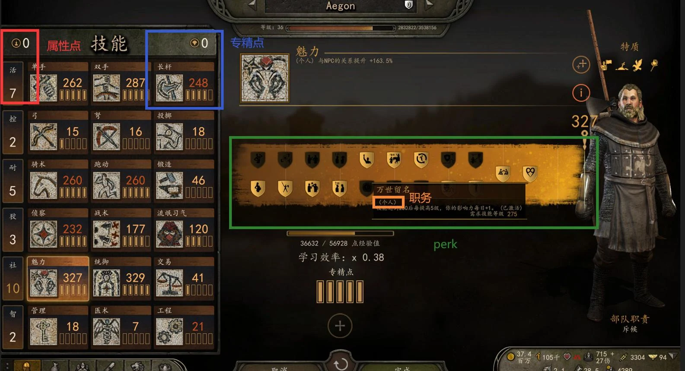
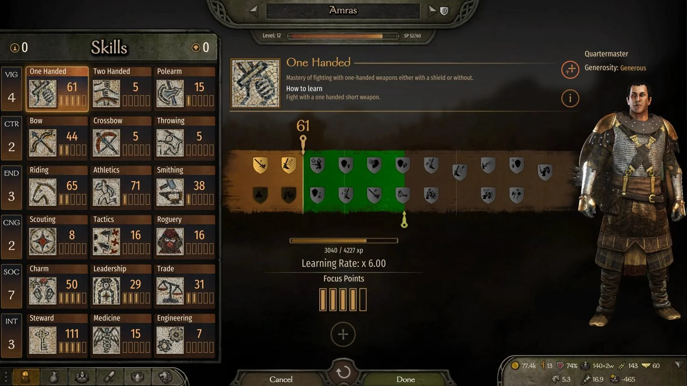
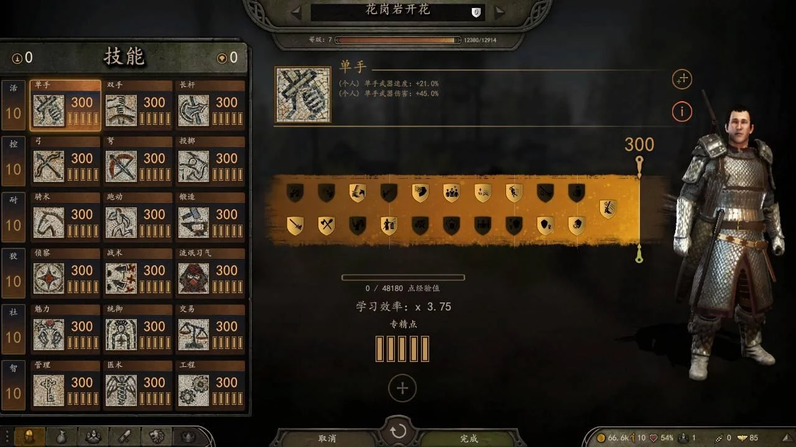

刚进入卡拉迪亚，人物面板上挤着属性、技能、专精点和一整排特长。很容易以为：把点数加上去，角色就立刻变强了。

骑砍2的成长要多走一步：**加点给成长创造条件，实际行动让技能涨起来，技能等级再打开特长。** 想走骑马、长杆、带兵的路线，先分清这几件事，比照抄一套毕业加点更有用。

这是「骑马与砍杀2 · 前期开荒指南」的第一篇，先把人物成长讲清楚。武器、锻造与带兵会留给后续篇目。

> 版本说明：整理自《确认骑砍2版本》中关于属性与专精点的讨论。原对话提到了 v1.4.7，但本篇没有读取你的游戏安装文件来确认版本。以下公式作为参考模型；MOD 或其他版本请以角色面板的实际学习效率为准。配图沿用原对话中的旧版本截图，只用来辨认界面位置。

## 先认识面板上的四种成长数据

在默认键位下，按 **C** 打开角色界面。先看左侧属性和技能，再看选中技能后的右侧详情。



*原对话配图 · 来源：[3DM 技能系统说明](https://www.3dmgame.com/gl/3862573.html)。截图中的点数是示例角色数据。点击图片可查看大图。*

| 名称 | 影响什么 | 前期怎样理解 |
| --- | --- | --- |
| 属性点 Attribute | 同一属性下的一组技能 | 决定整体培养方向 |
| 专精点 Focus | 某一项技能的学习效率与成长空间 | 决定重点练什么 |
| 技能等级 Skill | 通过对应行为积累经验 | 真正练出来的熟练程度 |
| 技能特长 Perk | 达到门槛后可选择的能力 | 还要看生效身份与职责 |

例如，给耐力加一点，会影响骑术、跑动和锻造；给骑术加一点专精，只影响骑术。加完之后，仍要通过骑马行动和战斗等方式积累经验。

## 六种属性，为什么要提前选方向

原对话讨论的基础技能结构，是六种属性各管三项技能。不同汉化版本可能使用“活力／活”“社交／社”等不同写法。

| 属性 | 对应技能 | 培养方向 |
| --- | --- | --- |
| 活力 | 单手、双手、长杆 | 近战武器 |
| 控制 | 弓、弩、投掷 | 远程武器 |
| 耐力 | 骑术、跑动、锻造 | 移动与锻造 |
| 狡诈 | 侦察、战术、流氓习气 | 行军、战术与非常规手段 |
| 社交 | 魅力、统御、交易 | 人际、统兵与经商 |
| 智力 | 管理、医术、工程 | 部队后勤与攻城 |

普通加点界面中，基础属性上限为 10，单项技能专精最多 5。常规升级通常每级给一个专精点，每四级给一个属性点；初始背景、年龄与特长奖励会影响实际可用点数。[角色规划器的规则提取说明](https://github.com/alcaras/bannerlord-character-builder)

我的前期取舍是：**先确定主武器和战斗方式，把专精集中到真正经常使用的技能上。** 骑马长杆路线，可以先照顾长杆与骑术；如果弓、弩几乎不用，就不用为了面板整齐而平均投入。属性点更稀缺，花之前想想同一组里还有没有你想培养的技能。

## 绿色范围，为什么不是最终技能上限



*原对话配图 · 来源：[Confreaks & Geeks 游戏评测](https://www.confreaksandgeeks.com/mount-blade-2-bannerlord-review/)。这是一张旧界面截图，不能用来验证当前版本公式。*

这张图里，有三处容易混在一起：技能树上方的数字是当前技能等级；绿色区域表示学习范围；下方带有 XP 数字的细条才是当前等级的经验进度。

超过绿色范围后，技能并不一定马上停止增长。更准确的理解是：先进入学习效率衰减区间，再到普通学习效率归零的位置。发现某项技能很难再涨时，可以查看它的学习倍率，再判断是否需要增加对应属性或专精。

用 **A 表示属性、F 表示专精**，原对话给出的参考公式为：

```text
学习软上限 L = 10 × (A − 1) + 30 × F
零学习阈值 M = 14 × (A − 1) + 40 × F + 4
```

这两条公式与 [Bannerlord Perk Analyzer 的阈值分析](https://github.com/JohnnyBraver/Bannerlord-Perk-Analyzer/blob/main/Docs/reports/perk-limits.md)一致。这里保留“阈值”的叫法：它表示在这组加点下，普通学习何时停下来，不保证角色等级绝不会超过它。一次较大的经验结算也可能越过该位置。

例如 **5 耐力、5 骑术专精**，参考模型得到 L = 190、M = 260。到了 190 之后仍有成长空间，但会逐渐难练；把耐力提高到 7，两个数会变为 210 和 288。

## 拖动一下，看看加点改变了什么

模拟器默认使用刚才的“5 属性、5 专精”。试着保持专精不动，提高属性；再把属性固定，比较 0 到 5 点专精的差别。

<!-- bannerlord-growth -->

这个模型里，增加一点属性，软上限提高 10、零学习阈值提高 14；增加一点专精，软上限提高 30、零学习阈值提高 40。属性同时作用于三项关联技能，专精集中作用于一项技能，因此两种点数承担不同的规划任务。

图中曲线是帮助理解区间的概念示意。没有核实你的版本与实际倍率公式，所以不展示具体“几倍学习速度”，也不用它估算练级时间。

## 技能特长，要看谁在什么位置生效



*原对话配图 · 来源：[骑砍中文站 1.6.2 主角 Perk 分析](https://bbs.mountblade.com.cn/thread-2081140-1-1.html)。图中全技能 300 的角色仅作界面展示，不是前期开荒目标。*

技能树上的小图标是特长。很多特长按 25 级间隔出现，但具体门槛、配对与效果要看当前版本说明。**达到等级后，记得检查是否有待选择的特长。**

选择时，先读生效身份。同一个特长可能有不止一种效果，每一条都需要分别检查。

| 身份 | 阅读提示 |
| --- | --- |
| 个人 | 是否作用于角色自身 |
| 队长 | 是否需要带领对应编队 |
| 部队领袖 | 是否需要担任这支部队的领袖 |
| 军需官 | 是否由该角色承担军需官职责 |
| 总督 | 是否需要被任命为城镇或城堡总督 |
| 家族领袖 | 是否需要担任家族领袖 |

例如，一个长期跟随主角行军的同伴，即使选了很漂亮的总督效果，也要等担任总督时才能发挥相应作用。主角培养和同伴分工最好一起考虑。

## 以骑兵统帅为例，先搭起自己的路线

原对话里，我想骑马拿长杆武器，也希望以后能带兵。下面这组数值保留为**中后期方向示例**，用来理解取舍，不是新建角色就能照填的开局方案。它也没有计算创建背景和额外奖励的完整点数预算。

| 属性 | 方向示例 | 考虑的能力 |
| --- | ---: | --- |
| 活力 | 5 | 长杆为主，单手备用 |
| 控制 | 2 | 暂时少投入远程 |
| 耐力 | 5 | 骑术与机动 |
| 狡诈 | 3 | 侦察等能力结合队伍分工 |
| 社交 | 7 | 统御与魅力的长期成长 |
| 智力 | 3 | 后勤职责结合同伴分担 |

对应的专精方向是：长杆、骑术、统御、魅力各以 5 为长期目标，单手和管理各以 3 为参考。**这些是目标，不要求每次升级机械地轮流加点。** 优先看当下真正用得多、开始遇到成长瓶颈的技能。

前期可以按这个顺序检查：

1. 先确定主武器，查看对应技能的专精和学习倍率。
2. 骑马作战就关注骑术；换成挥砍型长杆武器时，也先看它在物品面板中的技能归属。
3. 有可选特长时，读完生效身份，再决定选择。
4. 逐步安排军需官、侦察兵、医生与工程师，减少主角同时包办所有技能的压力。
5. 每次拿到稀缺属性点，想想它能同时照顾哪些长期目标。

这里有一个容易忽略的限制：按上面的参考模型，5 属性、5 专精的零学习阈值是 260。如果目标特长要求 275，就需要继续规划属性；7 属性、5 专精对应的阈值是 288。能在模型中达到门槛，也不等于很快就能练到。

## 从加点面板回到实际开荒

这套系统把“方向”和“练习”连在一起：属性决定一组技能的培养空间，专精帮助你集中投入，实际行为积累技能经验，特长再把成长转成具体能力。

我更愿意先把骑马、主武器和带兵这条路线走通，再根据队伍缺什么来补。下一次打开角色面板时，先问自己：**我最近在用什么，这项技能还能不能学，想拿的特长由谁来发挥作用？** 想清楚这三件事，加点就有了理由。

后续准备继续整理骑战武器、锻造材料与招兵练兵，逐篇补进这个合集。

## 资料与配图

本文根据自己的 ChatGPT 对话《确认骑砍2版本》中属性与专精点部分重新整理。三张配图均从原对话下载到本站，来源分别标注在图下，游戏画面及原图权利归相应权利人所有。

机制核对参考：[角色规划器及规则提取说明](https://github.com/alcaras/bannerlord-character-builder)、[Perk Analyzer 阈值分析](https://github.com/JohnnyBraver/Bannerlord-Perk-Analyzer/blob/main/Docs/reports/perk-limits.md)。[TaleWorlds 开发文档](https://apidoc.bannerlord.com/v/1.3.4/class_tale_worlds_1_1_campaign_system_1_1_game_components_1_1_default_character_development_model.html)列出了学习范围和倍率的计算接口，但该页面没有公式实现，不能单独作为当前版本数值验证。
