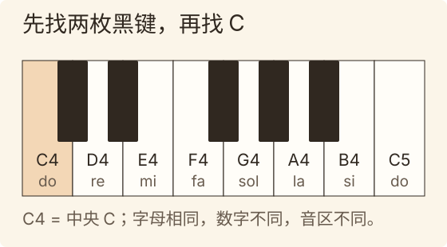
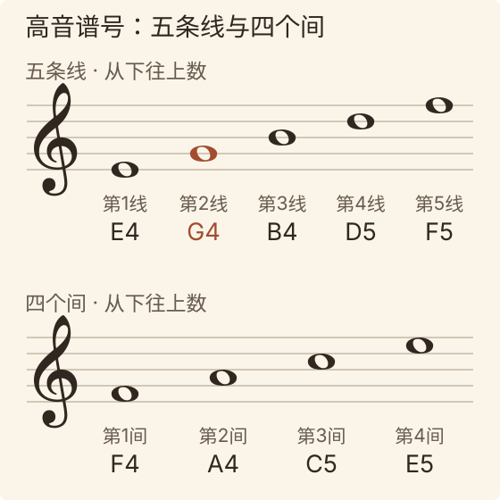
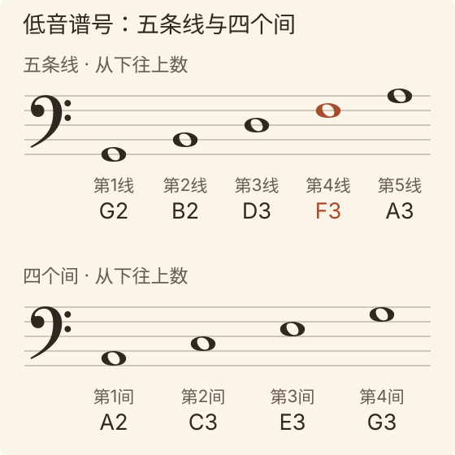
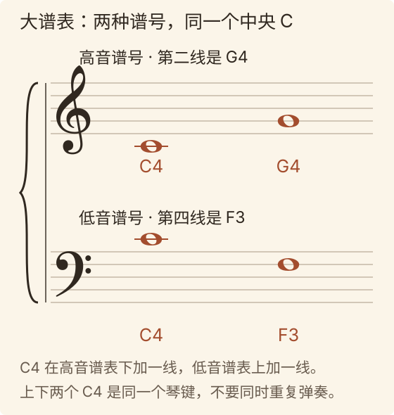
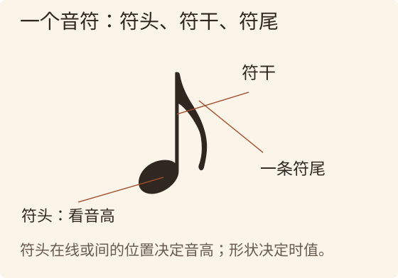
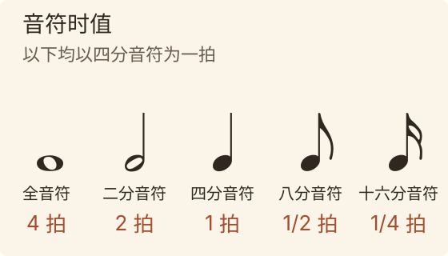
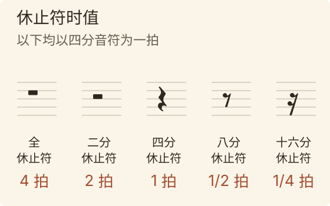
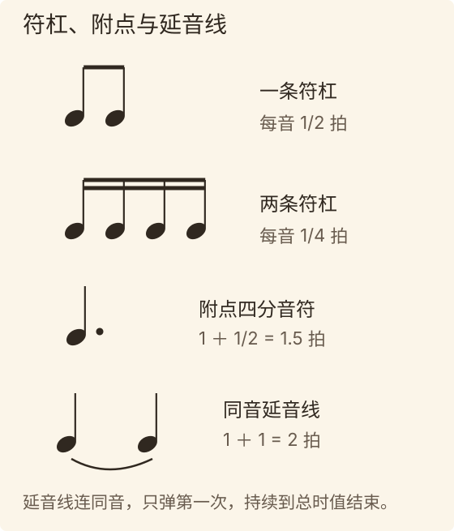
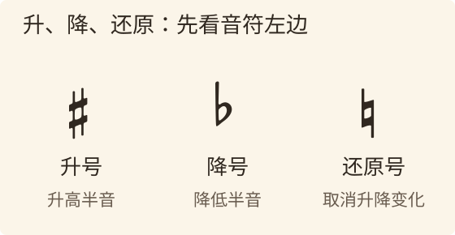
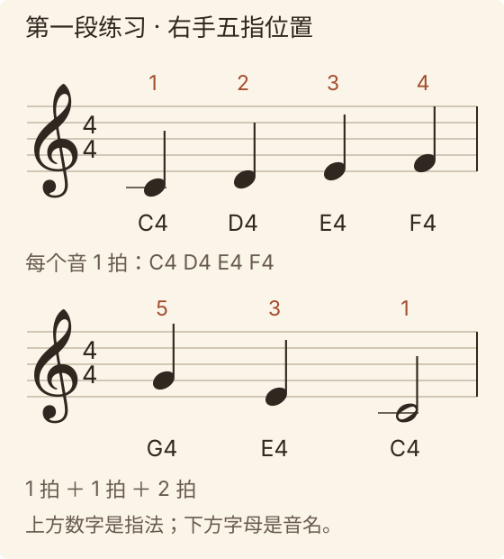

刚开始学钢琴，最难的往往不是按下琴键，而是同时想清楚三件事：**弹哪个音、用哪根手指、持续多久。** 这篇就从这三件事开始。

先认键盘和谱号，再读音高与节奏，最后坐到琴前练一小段。每张示意图都可以点击放大；音名也用文字表格列出，方便边练边查。

> 阅读约定：本文使用科学音高记号，中央 C 写作 **C4**；有些电子琴或软件会把同一音叫 C3。唱名采用 C 大调中的 do、re、mi、fa、sol、la、si 对照。时值示例统一按 **四分音符为一拍**、以 4/4 拍练习；不要把这个条件推广到所有拍号。

## 先在琴键上找到中央 C

黑键按照“两枚一组、三枚一组”反复排列。找到任意一组两枚黑键，它左侧紧挨着的白键就是 **C**。再找到键盘中部附近的那个 C，它就是中央 C。

白键往右走，音名循环为：

| 音名 | C | D | E | F | G | A | B |
| --- | --- | --- | --- | --- | --- | --- | --- |
| 本文唱名 | do | re | mi | fa | sol | la | si |

数字用来区分音区：C3、C4、C5 都叫 C，但越往右声音越高。这里的 C4 到下一个 C5 相隔一个八度。**指法数字和音名后面的数字是两回事**：C4 的 4 表示音区，不表示用无名指弹。[键盘与大谱表参考](https://viva.pressbooks.pub/openmusictheory/chapter/the-keyboard-and-grand-staff/)

先做一个小动作：找到三个不同音区的 C，依次弹出来，听听“名字相同、音高不同”的感觉。

## 五线谱怎么读：从下往上数线和间

五线谱有五条线，夹着四个间。**最下面是第一线，最上面是第五线；最下面的间是第一间。** 符头压在线上，或放在两线之间，都有明确的位置。

音符向上移动一个相邻位置——从线到间，或从间到线——自然音名就往前走一步。例如 E、F、G、A。需要知道具体是哪个音，先看左边的谱号；同一个谱面位置，换了谱号，音名就会改变。

这时先把两个问题分开：**符头的位置决定音高，音符的形状决定时值。** 不要根据符干向上或向下，判断声音高低。

## 高音谱号：第二线上的 G 是定位点

高音谱号又叫 **G 谱号**，它圈定的第二线是中央 C 上方的 G，也就是 **G4**。先记住这个定位点，再向上、向下推相邻音。

| 位置（从下往上） | 音名 | 本文唱名 |
| --- | --- | --- |
| 第一线 | E4 | mi |
| 第一间 | F4 | fa |
| 第二线 | G4 | sol |
| 第二间 | A4 | la |
| 第三线 | B4 | si |
| 第三间 | C5 | do |
| 第四线 | D5 | re |
| 第四间 | E5 | mi |
| 第五线 | F5 | fa |

可以分两组记：五条线是 **E G B D F**，四个间是 **F A C E**。更实用的练法是随机指一个位置，说出音名，再去琴上找它。暂时不用追求速度。

## 低音谱号：两点夹着的第四线是 F

低音谱号又叫 **F 谱号**。它右边两个点夹着第四线，这条线对应 **F3**。它与高音谱号的定位方式不同，不能直接沿用高音谱表的位置记忆。

| 位置（从下往上） | 音名 | 本文唱名 |
| --- | --- | --- |
| 第一线 | G2 | sol |
| 第一间 | A2 | la |
| 第二线 | B2 | si |
| 第二间 | C3 | do |
| 第三线 | D3 | re |
| 第三间 | E3 | mi |
| 第四线 | F3 | fa |
| 第四间 | G3 | sol |
| 第五线 | A3 | la |

低音谱表五条线是 **G B D F A**，四个间是 **A C E G**。先认 C3、F3 这类定位音，再练相邻的线、间，通常比把整张表反复从头数到尾更方便。[高低音谱号的音高位置参考](https://viva.pressbooks.pub/openmusictheory/chapter/clefs/)

## 大谱表与加线：中央 C 有两种写法

钢琴谱常把两组五线谱用左侧的大括号连起来，组成**大谱表**。初级曲目通常上面供右手读、下面供左手读，但谱号本身表示音高位置；实际分手仍要看曲谱和指法。

五条线不够用时，可以在上方或下方添加短短的**加线**。中央 C 的两种常见写法是：高音谱表的**下加一线**，以及低音谱表的**上加一线**。它们对应同一个琴键，图中是两种写法的对照，不要求把这个音同时弹两次。

再顺手认几个边缘位置：

| 谱表 | 位置 | 音名 |
| --- | --- | --- |
| 高音 | 第一线下方紧邻的间 | D4 |
| 高音 | 下加一线 | C4 |
| 高音 | 第五线上方紧邻的间 | G5 |
| 高音 | 上加一线 | A5 |
| 低音 | 第一线下方紧邻的间 | F2 |
| 低音 | 下加一线 | E2 |
| 低音 | 第五线上方紧邻的间 | B3 |
| 低音 | 上加一线 | C4 |

## 音符的结构：符头、符干与符尾

**符头**是椭圆形的部分，可以空心或实心；**符干**是竖线；**符尾**是从符干伸出的尾巴。认识这些结构，就能辨认下面五种常见音符。

| 名称 | 怎么认 | 四分音符为一拍时 | 占全音符的比例 |
| --- | --- | ---: | ---: |
| 全音符 | 空心符头，没有符干 | 4 拍 | 1 |
| 二分音符 | 空心符头，有符干 | 2 拍 | 1/2 |
| 四分音符 | 实心符头，有符干，无符尾 | 1 拍 | 1/4 |
| 八分音符 | 实心符头，一条符尾或一条符杠 | 1/2 拍 | 1/8 |
| 十六分音符 | 实心符头，两条符尾或两条符杠 | 1/4 拍 | 1/16 |

换算关系是：**1 个全音符 = 2 个二分音符 = 4 个四分音符 = 8 个八分音符 = 16 个十六分音符。** “二分”表示全音符的一半，“十六分”表示全音符的十六分之一，不表示按住十六拍。[音符结构与时值参考](https://odp.library.tamu.edu/stepstomusictheory/chapter/the-basics/)

## 节拍怎么数：先学会把一拍均分

**4/4** 的上方数字表示每小节有四个四分音符单位，下方的 4 表示以四分音符为记谱单位。在这篇入门练习中，每小节数四拍：**1、2、3、4**。小节线把小节分开；数到下一个小节时，再从 1 开始。

先用手轻拍均匀的大拍，再把每拍分成两份或四份：

| 音符 | 一拍里有几个 | 口数示例 |
| --- | ---: | --- |
| 四分音符 | 1 | `1　2　3　4` |
| 八分音符 | 2 | `1 & 2 & 3 & 4 &` |
| 十六分音符 | 4 | `1 e & a 2 e & a 3 e & a 4 e & a` |

`&` 可以读作“and”。不习惯英文时，也可以先用“哒、哒”均分，关键是每个大拍之间的时间始终相等。练八分音符时，在同样的大拍里放进两个音；不要一看到短音符，就把整首的速度一起加快。

第一次可以把节拍器设为 **每分钟 60 次，每次点击是一拍**。这是本文练习的起点建议，觉得来不及认音就再慢一些。先拍手念节奏，再上琴。

## 休止符：不发声，也要继续数拍

| 名称 | 识别提示 | 本文练习中的时值 |
| --- | --- | ---: |
| 全休止符 | 小方块挂在第四线下方 | 4 拍 |
| 二分休止符 | 小方块坐在第三线上方 | 2 拍 |
| 四分休止符 | 折线形符号 | 1 拍 |
| 八分休止符 | 一个钩状部分 | 1/2 拍 |
| 十六分休止符 | 两个钩状部分 | 1/4 拍 |

休止的时间也属于音乐，手停下来，心里的拍子继续走。**全小节休止**常用全休止符的形状表示，这时要停满实际整小节，不能不看拍号就固定数四拍。[休止与整小节休止参考](https://viva.pressbooks.pub/openmusictheory/chapter/simple-meter-and-time-signatures/)

## 符杠、附点和延音线：把时值读完整

相邻的八分、十六分音符常用**符杠**连成组，便于看清节拍。一条杠对应八分音符，两条杠对应十六分音符；连起来不会额外增加时值。

**附点**写在音符右侧，增加原时值的一半。四分音符 1 拍，加附点后是 1.5 拍；二分音符 2 拍，加附点后是 3 拍。

**延音线**连接相同音高的音符，把时值相加，后一个音不重新弹。例如图中两个四分音符连起来，第一下发音后保持两拍。外形相似的连奏线可以连接不同音高，提示连贯演奏，不能把它也理解成“后面的音都不弹”。[节奏记谱参考](https://viva.pressbooks.pub/openmusictheory/chapter/notating-rhythm/)

## 再认几个常见标记：升降号、力度与速度

**升号 ♯** 把音升高半音，**降号 ♭** 把音降低半音，**还原号 ♮** 取消相应的升降变化。钢琴上相邻的琴键——包括黑键——相差半音；E 与 F、B 与 C 之间没有黑键，它们也是半音关系。不要把“升音”直接理解成“一定弹黑键”。[半音与变音记号参考](https://viva.pressbooks.pub/openmusictheory/chapter/half-and-whole-steps/)

这篇的原创练习没有调号或临时升降号，先只弹白键。以后看新谱时，要检查谱号后面的调号，以及音符左边的临时记号。

| 标记 | 意思 | 初学时怎么做 |
| --- | --- | --- |
| p / mf / f | 弱 / 中强 / 强 | 在舒适动作下做音量对比 |
| 渐强 / 渐弱的楔形线 | 音量逐渐增加 / 减小 | 不要突然改变音量 |
| 音符上方或下方的小点 | 断奏记号 | 与音符右边延长时值的附点区分 |
| 四分音符 = 60 | 每分钟 60 个四分音符 | 本文练习中相当于每秒一拍 |
| 竖线 / 终止线 | 小节边界 / 段落或乐曲结束 | 继续按音符和休止符数拍 |

这些符号可以逐步掌握，第一天先认清谱号、音名、基本时值和拍号即可。[力度与其他记谱标记参考](https://viva.pressbooks.pub/openmusictheory/chapter/other-aspects-of-notation/)

## 坐到琴前：指法与第一段练习

先坐稳，肩膀自然放松，手腕保持舒适，手指自然弯曲。调节座位，让手肘大致与键盘同高，前臂能够轻松活动。不要为了“手型标准”把手绷住。[Yamaha 坐姿说明](https://www.yamaha.com/en/musical_instrument_guide/piano/play/play002.html)

两只手的指法编号相同：**拇指 1、食指 2、中指 3、无名指 4、小指 5**。左右手的编号不反过来，但从左向右依次弹琴键时，手指顺序会不同。[Yamaha 指法编号说明](https://hub.yamaha.com/keyboards/k-how-to/the-basics-of-piano-keyboard-fingering/)

先做五指练习：

| 手 | 起始位置 | 音名顺序 | 指法顺序 |
| --- | --- | --- | --- |
| 右手 | 拇指放 C4 | C4 D4 E4 F4 G4 F4 E4 D4 C4 | 1 2 3 4 5 4 3 2 1 |
| 左手 | 小指放 C3 | C3 D3 E3 F3 G3 F3 E3 D3 C3 | 5 4 3 2 1 2 3 4 5 |

这是固定五指位置练习，先分手慢弹，每个音均匀一拍；它还不是跨八度的完整音阶指法。听清每个音，再放下下一个手指。

接着试试下面的两小节原创练习。上方数字是建议指法，下方字母是音名。

第一小节：**C4、D4、E4、F4**，分别在 1、2、3、4 拍开始弹。第二小节：第 1 拍弹 **G4**，第 2 拍弹 **E4**，第 3 拍弹 **C4**，保持经过第 4 拍，直到这个小节结束。最后的 C 是二分音符，不能在第 4 拍再敲一次。

先念出音名，再拍出节奏，最后把右手放上去。暂时不踩延音踏板，留心每次发音和收音。

## 每天二十分钟，怎样安排

下面是一个可以调整的起点，按自己的熟练程度分配时间：

| 时间 | 做什么 | 检查什么 |
| --- | --- | --- |
| 3 分钟 | 找 C3、C4、G4、F3，随机认谱 | 能否把谱面位置对应到琴键 |
| 4 分钟 | 拍四分、八分音符与休止 | 大拍是否均匀，休止时是否漏数 |
| 5 分钟 | 分手五指练习 | 音是否清楚，动作是否放松 |
| 6 分钟 | 练上面两小节 | 最后的二分音符是否保持足够 |
| 2 分钟 | 录一遍，记下一个问题 | 下次只优先解决哪一处 |

连续几次能慢速弹稳，再稍微加快。遇到同一处总停顿，就单独练那个小节或两个音之间的连接；不必每次都从第一小节重新冲一遍。

给自己一个明确的小目标：**看到谱号能找到定位音，看到常见音符能说出时值，弹完两小节时拍子仍然连贯。** 在这个基础上，再慢慢增加双手配合和曲目长度。

## 资料与配图

乐理核对参考上文链接的 Open Music Theory、Steps to Music Theory，以及 Yamaha 钢琴教学资料。练习顺序、二十分钟安排和两小节练习谱为本站编写的入门示例。

十张图均在项目中绘制并保存，乐谱符号使用 Steinberg 的 [Bravura 开源音乐字体](https://github.com/steinbergmedia/bravura)，导出为不依赖外部字体的 SVG。图示和字体许可说明随素材保存，可点击图片查看大图。
