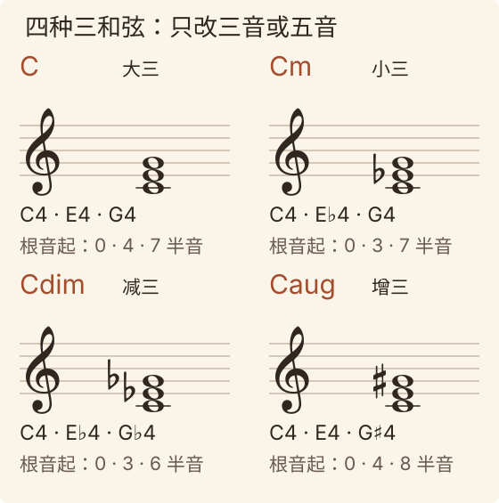
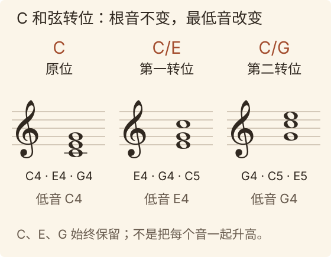
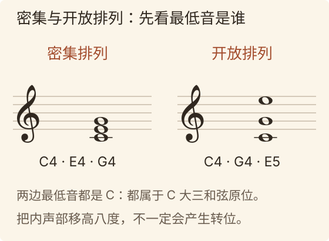
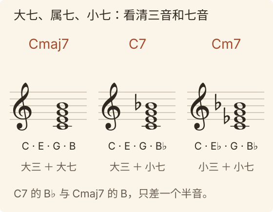
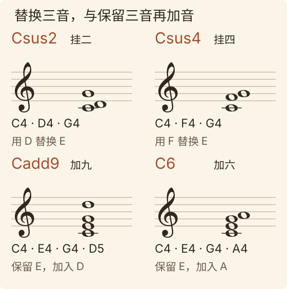
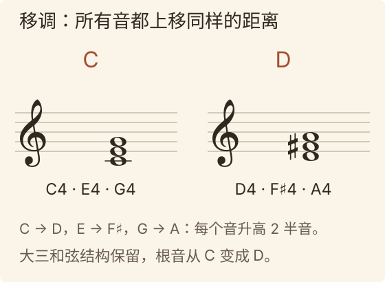
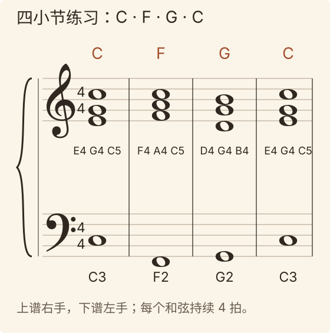

[第一篇](/module/jupiter/2026-11-26-piano-beginner-guide)解决了“一个音在哪里、持续多久”。第二篇开始把几个音放在一起：看懂和弦名称，找到琴键，再把不同和弦连起来。

“移位和弦”在日常说法里，可能指几种不同操作。这篇会分别讲清：**换最低音的转位、整体升降的移调，以及把音拉开的开放排列。** 三者都能改变手的位置，但改变的内容不同。

> 阅读约定：中央 C 仍记为 C4。和弦公式中的 1、3、5 是相对根音的音级，**不是指法**；半音数从根音记作 0。以下练习按四分音符为一拍、4/4 拍进行，谱例中的和弦音均已标出。

## 先搭一个 C 和弦：根音、三音、五音

先在右手找到 **C4、E4、G4**，同时弹下去。这是 **C 大三和弦**，和弦符号直接写 **C**。

把音从低到高按三度叠起来，C 是根音，E 是三音，G 是五音。称为“三音”，是因为从 C 数自然音名 C、D、E，E 位于第三个；数音程时起点和终点都算。

| 和弦音 | 在 C 和弦中 | 距离根音 |
| --- | --- | --- |
| 根音 | C | 0 个半音 |
| 三音 | E | 4 个半音，大三度 |
| 五音 | G | 7 个半音，纯五度 |

相邻琴键之间是一个半音，黑键也要算。C 到 E 的四个半音是 C→C♯→D→D♯→E，不能只数白键。E 到 G 又是三个半音，所以大三和弦也可以记为从下往上 **4＋3**。[三和弦构成参考](https://musictheory.pugetsound.edu/mt21c/TriadsIntroduction.html)

可以先用右手 1、3、5 指弹 C4、E4、G4。这只是这一组琴键的入门指法，不代表所有和弦、所有转位都固定用同一套手指。

## 四种基础三和弦：大、小、减、增

保留 C 为根音，改动三音或五音，就得到四种常见三和弦。先比较位置，再自己听声音的变化。

| 名称 | 常见符号 | 相对根音的公式 | C 为根音时 | 相邻音的半音间距 |
| --- | --- | --- | --- | --- |
| 大三和弦 | C | 1－3－5 | C E G | 4＋3 |
| 小三和弦 | Cm | 1－♭3－5 | C E♭ G | 3＋4 |
| 减三和弦 | Cdim / C° | 1－♭3－♭5 | C E♭ G♭ | 3＋3 |
| 增三和弦 | Caug / C+ | 1－3－♯5 | C E G♯ | 4＋4 |

公式里的变音以根音对应的大调音级为参照。例如 C 的三音 E 降低半音变成 E♭，C 就变成 Cm；不能把 Cm 当成“C 和弦随便少弹一个音”。

练习时依次弹 **C → Cm → Cdim**，观察 E 怎样变成 E♭，G 又怎样变成 G♭；再回到 C，把 G 升到 G♯，听 Caug。先保持速度、力度和音区相近，才容易比较结构变化带来的听感。大小和弦的听感还受节奏、配器和上下文影响，不必把它们机械地等同于“快乐”和“悲伤”。

## 先会读常见名称，再扩展到其他根音

和弦名称从左往右读：**字母给出根音，后面的符号说明结构。** C 是 C 大三和弦，Cm 是 C 小三和弦，Am 则是 A 小三和弦。根音带升降号时，那也是名称的一部分，例如 B♭ 是降 B 大三和弦。

先认一组 C 大调里常用的三和弦：

| 和弦 | 组成音 | C 大调中的级数 |
| --- | --- | --- |
| C | C E G | I |
| Dm | D F A | ii |
| Em | E G B | iii |
| F | F A C | IV |
| G | G B D | V |
| Am | A C E | vi |
| Bdim | B D F | vii° |

这里大写罗马数字表示大三和弦，小写表示小三和弦，小圆圈表示减三和弦。“C 大调的第二级和弦”是 **Dm**，并不是把 C 的三根手指全部向右移一个白键就一定得到另一个大三和弦。

初练可以先掌握 C、F、G、Am。把每个和弦的三个音分开弹一次，再同时弹一次，检查有没有漏音或夹进旁边的键。这是本文建议的练习顺序，不是必须遵守的学习进度。

## 转位：换最低音，根音并没有改名

C4－E4－G4 是 C 和弦原位。把最下面的 C4 升高一个八度，再从低到高排列，就得到 E4－G4－C5；再把最下面的 E4 升高八度，得到 G4－C5－E5。

| 位置 | 由低到高的一种弹法 | 最低音 | 根音 | 常见写法 |
| --- | --- | --- | --- | --- |
| 原位 | C4 E4 G4 | C4 | C | C |
| 第一转位 | E4 G4 C5 | E4（三音） | C | C/E |
| 第二转位 | G4 C5 E5 | G4（五音） | C | C/G |

**根音是和弦的身份，低音是此刻实际发声的最低音。** 转位后，根音仍然是 C，只是 E 或 G 来到最下面；第一转位不等于“变成 E 和弦”。这些位置也会影响听感和连接方式，不能因此认定它们在所有乐句中都可以随意互换。[转位定义参考](https://musictheory.pugetsound.edu/mt21c/InvertedTriads.html)

先弹这三个紧凑位置，暂时不加左手。可以试用 **1－3－5、1－2－5、1－3－5**，但要根据手的大小调整。先在落键前摆好位置，再慢慢弹齐，不用追求大幅抬手。

## 斜杠和弦：右边写的是整组声音的低音

**C/E** 的斜杠左边表示 C 和弦，右边要求 E 在低部。实际双手弹奏时，可以左手弹 E3，右手弹 C4－E4－G4，整组声音的最低音仍是 E。

这里容易混淆两件事：

- 右手弹 E4－G4－C5，但左手加一个更低的 C3，整组声音的低音是 C，整体仍是 C 和弦原位。
- 右手弹 C4－E4－G4，左手弹 E3，整体才符合 C/E。

所以看转位时，要把**两只手所有正在发声的音**一起考虑。右手手型是第一转位，并不自动意味着整组和声就是第一转位。

斜杠后也可以是和弦之外的音，例如 **C/D** 表示 C 和弦配 D 低音；D 不属于 C 三和弦，它就不是 C 三和弦的普通转位。先把 C/E、C/G、F/A 这类情况认熟，再慢慢增加其他斜杠低音。

## 密集与开放排列：把音拉开，也未必是转位

C4－E4－G4 比较紧凑。把其中的 E4 移到上方 E5，再排列为 **C4－G4－E5**，音之间的距离变宽，但最低音还是 C4，因此两者都是 C 和弦原位。

可以这样检查：**问转位，先找最低音；问排列，再看其他音分布在哪些音区。** 把整个 C4－E4－G4 同时提高八度变成 C5－E5－G5，也仍是原位，只是整体换了音区。

开放排列不需要一只手硬跨过去。图中的 C4－G4－E5，可以左手弹 C4，右手弹 G4、E5；先听清音区差异，不必把示意图理解成固定的单手指法。

## 七和弦：重点分清 Cmaj7、C7 与 Cm7

在三和弦上继续叠一个三度，会形成四个音的七和弦。先掌握下面三种，比一次背很多缩写更容易比较。

| 名称 | 符号 | 构成 | C 为根音时 |
| --- | --- | --- | --- |
| 大七和弦 | Cmaj7 | 大三和弦＋大七度 | C E G B |
| 属七结构（大小七） | C7 | 大三和弦＋小七度 | C E G B♭ |
| 小七和弦 | Cm7 | 小三和弦＋小七度 | C E♭ G B♭ |

**C7 的七音是 B♭，Cmaj7 的七音才是 B。** 这里的 7 表示七度关系，不是“加入第七个音”或“弹七个音”。C7 描述和弦结构；它在某一首曲子里承担什么功能，还要结合调性与前后和弦判断。[七和弦结构参考](https://musictheory.pugetsound.edu/mt21c/SeventhChordsIntroduction.html)

七和弦有四个和弦音，因此在原位之外，还可以有第一、第二、第三转位，分别以三音、五音、七音为低音。比如 C7/B♭ 的一组排列是 B♭3－C4－E4－G4。

不用一开始就单手按满四个音。可以左手弹根音，右手弹另外三个音，或先慢慢分解，再合起来听。先听 **C → Cmaj7 → C7 → Cm7**，留意 B 与 B♭、E 与 E♭ 的变化。

## 挂留与加音：sus 是替换，add 是保留再添加

变种和弦中，最值得先分清的是“换掉三音”和“保留三音再加一个音”。

| 符号 | 组成音 | 怎样从 C 和弦出发 |
| --- | --- | --- |
| Csus2 | C D G | 用二音 D 替换三音 E |
| Csus4 / Csus | C F G | 用四音 F 替换三音 E |
| Cadd9 | C E G D | 保留 E，再加入九音 D |
| C6 | C E G A | 保留 E，再加入六音 A |

**Csus2 没有 E，Cadd9 有 E。** D 是相对 C 的二音，放到上方八度就是九音；add9 不强制它永远待在最高声部，图里用 D5 是为了看清完整构成。C6 这里采用流行和弦符号的“加六”含义，与古典数字低音里表示转位的数字 6 不是同一套标记。[挂留结构参考](https://musictheory.pugetsound.edu/mt21c/SimpleSusChords.html)、[和弦符号参考](https://musictheory.pugetsound.edu/mt21c/ChordSymbolSpecifics.html)

还要分清 **Cadd9** 和 **C9**：前者是 C－E－G－D；后者通常指带小七度的属九和弦，完整构成为 C－E－G－B♭－D。不能只因为它们都有 D，就把两个名称混用。

先试 **Csus4 → C**：保留 C、G，让 F 回到 E，听一个声部怎样移动。挂留和弦也可以在现代音乐中独立使用，并非每次出现都必须马上解决。接着比较 C 与 Cadd9，感受“多加一个音”与“把原来的音换掉”的区别。

## 移调：整体升降时，距离必须一起保留

把 C4－E4－G4 的每一个音都升高两个半音，得到 **D4－F♯4－A4**。这仍是大三和弦结构，但根音变成 D，所以名称变成 D。

如果改成 D－F－A，得到的是 Dm，并没有保持原来的大三和弦结构。钢琴黑白键分布不均匀，因此不能只照着白键的外形平移手指。[同音程移调参考](https://odp.library.tamu.edu/stepstomusictheory/chapter/more-intervals/)

| 操作 | 从 C4 E4 G4 出发的一种结果 | 保留了什么 |
| --- | --- | --- |
| 第一转位 | E4 G4 C5 | C、E、G 的音级身份，改变低音 |
| 开放排列 | C4 G4 E5 | 低音仍为 C，拉开内部间距 |
| 整体提高八度 | C5 E5 G5 | 和弦名称与原位，改变音区 |
| 向上移调大二度 | D4 F♯4 A4 | 大三结构，根音改变 |

和弦进行也能按同一思路移调。**C－F－G－C** 全部升高大二度，变成 **D－G－A－D**。本篇先掌握这类结构明确的练习，不要求马上把整首歌曲搬到所有调上。

## 用练习区比较结构、转位与根音

先保持根音 C，切换“大三”“小三”“大七”“属七结构”；再选大三和弦，依次比较原位、第一转位、第二转位。最后保持“大三＋原位”，把根音从 C 改为 D，查看 F♯ 在哪个琴键上。

<!-- piano-chord-lab -->

“柱式”把和弦音同时弹下，“分解”则依次弹出它们。这两种演奏方式本身不会自动改变和弦的转位。试听使用短合成音，只用来比较音高关系；没有自动播放，也不需要在页面中录音。

练习区按所选根音给出一种明确命名。同一组音在不同语境中可能有其他解释，例如 C－E－G－A 既可以分析为 C6，也可能是 Am7 的一个转位。初学时先对照当前名称理解各个和弦音。

## 四个和弦连起来：用转位减少右手跳跃

如果每次都把右手和弦从根音开始向上叠，换和弦时手可能跳得比较远。下面这组 **C－F－G－C**，把右手安排在附近音区，左手先只弹单音低音。

| 小节 | 和弦 | 右手由低到高 | 左手低音 |
| --- | --- | --- | --- |
| 1 | C | E4 G4 C5 | C3 |
| 2 | F | F4 A4 C5 | F2 |
| 3 | G | D4 G4 B4 | G2 |
| 4 | C | E4 G4 C5 | C3 |

C 到 F 时，右手保留 C5，E4、G4 分别移到 F4、A4；回到 C 时，再观察哪些音能少移动。先听连接是否平顺，不急着加复杂节奏。这是便于入门弹奏的三声部安排，不是严格四部和声写作范例。

注意：这里右手用了转位手型，但左手最低音始终是相应根音，**整体和弦仍按 C、F、G、C 原位理解**，不用把第一小节误标成 C/E。

练法分三步：先只练右手换位，再只弹左手低音，最后合手。每小节第 1 拍落键，保持经过第 2、3、4 拍，在下一小节开始时换和弦。左手暂时不加八度，不要求一只手跨越整个谱例的音域。

## 一次二十分钟，先练会哪些事

| 时间 | 练什么 | 检查点 |
| --- | --- | --- |
| 4 分钟 | C、Cm、Cdim、Caug 慢速比较 | 能说出哪个音改变了 |
| 4 分钟 | C、C/E、C/G，只弹右手 | 根音不变，最低音逐次改变 |
| 4 分钟 | Cmaj7、C7、Csus4、Cadd9 | 不混淆 B / B♭，也不混淆 sus / add |
| 6 分钟 | 分手再合手弹 C－F－G－C | 先把四拍数稳，再追求换位流畅 |
| 2 分钟 | C 大三移到 D 大三 | 记得 F♯，每个音都升高两个半音 |

这只是可调整的练习安排。手忙时可以减少和弦种类，先练 C、F、G；四拍能稳定换和弦之后，再试每小节四次柱式，或一次次弹出低、中、高三个音。

今天先带走三个判断：**看和弦种类，检查音程结构；看转位，检查整组声音的最低音；看移调，检查每个音是否移动了相同距离。** 这些分清之后，新和弦名称就不再只是需要死记的缩写。

## 资料与配图

上文乐理说明参考 University of Puget Sound 的 Music Theory for the 21st-Century Classroom、Open Music Theory 和 Steps to Music Theory 的相关章节。公式、转位名称与移调示例用来说明基础结构；实际伴奏还要结合旋律、音区与具体曲谱。

七张 SVG 均为项目本地绘制，谱号与符头沿用第一篇的 Bravura 标准音乐符号，字体许可及生成说明随素材保存。和弦练习区、四小节练习和学习顺序为本站编写。

[回看第一篇：五线谱、时值与五指练习](/module/jupiter/2026-11-26-piano-beginner-guide)
